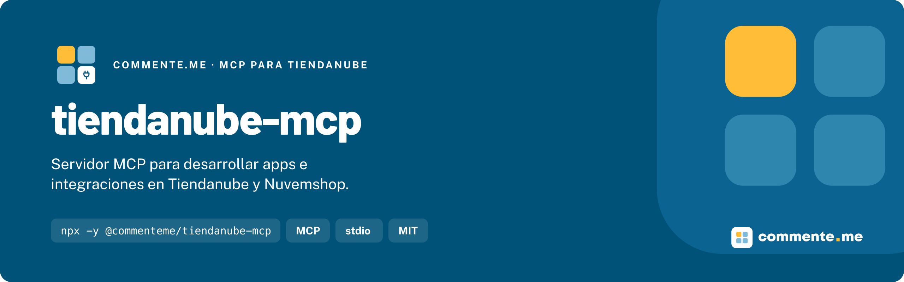

# tiendanube-mcp

**Servidor MCP para desarrollar apps e integraciones en Tiendanube y Nuvemshop.**


## Instalación

```bash
claude mcp add tiendanube -- npx -y @commenteme/tiendanube-mcp
```

Requiere Node `>= 18`. El cliente ejecuta el servidor con `npx`, así que no hace falta instalarlo. Para Claude Desktop, Cursor, Windsurf, VS Code y otros clientes, mira [Otros clientes](#otros-clientes).

## Uso rápido

Reinicia el cliente y pide lo que necesitas en lenguaje natural. El asistente elige la herramienta:

- "Que scope necesita `POST /orders/{id}/fulfillment-orders/{id}/tracking-events`?"
- "Arma el receptor de webhooks para `order/paid` y `app/uninstalled` con la verificación de firma"
- "Genera el flujo de instalación OAuth del app 1234"
- "Que eventos de webhook hay para fulfillment orders?"
- "Cómo funcionan los slots del checkout en NubeSDK?"

## Que incluye

Para quien escribe apps de partners e integraciones propias: Admin API, OAuth, webhooks, NubeSDK, apps del Admin y temas.

- **Documentación oficial en vivo**: `search-docs` y `read-doc` leen las páginas Markdown que nuvemshop.dev publica para agentes, en inglés, portugués o español. Cada respuesta trae la URL de la página.
- **Índices de la Admin API 2025-03, sin red**: 228 endpoints con el scope que piden y su página de referencia, los 18 grupos de scopes OAuth y los 57 eventos de webhook, con los tres de privacidad obligatorios aparte.
- **Scaffolding**: el receptor de webhooks (firma `x-linkedstore-hmac-sha256` sobre el body crudo, `200` inmediato y una prueba) y el flujo OAuth (redirección con `state` y canje del code con body JSON). Las herramientas devuelven los archivos (ruta y contenido) para que el cliente los escriba.
- **Sin credenciales**: no pide token de tienda, no escribe en disco y solo se conecta a nuvemshop.dev y tiendanube.dev.

Funciona con Claude Code, Claude Desktop, Cursor, VS Code, Windsurf y cualquier cliente MCP con transporte stdio.

## Por que existe

Tiendanube tiene un [Admin MCP](https://nuvemshop.dev/en-US/ai-agents/admin-mcp.md) oficial para operar una tienda conversando: crear productos, ajustar stock y precios, ver pedidos, manejar cupones y promociones. Si lo que necesitas es operar una tienda, ocupa ese. Para quien construye sobre la plataforma no había servidor: este responde que endpoint, que scope y que evento usar, y entrega el código de las partes que todo app repite. Va junto con las skills de [tiendanube-skills](https://github.com/commentemeapp/tiendanube-skills).

## Documentación

### Otros clientes

En `claude_desktop_config.json` (Claude Desktop), `~/.cursor/mcp.json` o `.cursor/mcp.json` (Cursor) y `~/.codeium/windsurf/mcp_config.json` (Windsurf):

```json
{
  "mcpServers": {
    "tiendanube": {
      "command": "npx",
      "args": ["-y", "@commenteme/tiendanube-mcp"]
    }
  }
}
```

En VS Code, `.vscode/mcp.json`:

```json
{
  "servers": {
    "tiendanube": {
      "type": "stdio",
      "command": "npx",
      "args": ["-y", "@commenteme/tiendanube-mcp"]
    }
  }
}
```

Cualquier cliente con transporte `stdio` sirve: el comando es `npx` y los argumentos, `-y @commenteme/tiendanube-mcp`. En Claude Code, `--scope project` deja la configuración en `.mcp.json` para compartirla con el equipo.

### Herramientas

| Herramienta                | Que hace                                                                                                         | Red |
| -------------------------- | ---------------------------------------------------------------------------------------------------------------- | --- |
| `search-docs`              | Busca en el índice `llms.txt` de la documentación y cita la mejor sección de las tres primeras páginas.          | Sí  |
| `read-doc`                 | Lee una página o una sección, por URL o ruta del sitio. Otros dominios se rechazan.                              | Sí  |
| `lookup-endpoint`          | Endpoint por ruta (acepta ids reales, versión y store id), recurso o palabras: URL completa, scope y referencia. | No  |
| `lookup-scope`             | Los scopes OAuth y los recursos que abren, o el scope de un recurso o una ruta.                                  | No  |
| `lookup-webhook-event`     | Los eventos de webhook por grupo, con como registrarlos y verificarlos.                                          | No  |
| `scaffold-webhook-handler` | Receptor Express en TypeScript con verificación de firma y una prueba con `node:test`.                           | No  |
| `scaffold-oauth-callback`  | Instalación OAuth en Express: `state`, canje del code y registro por app y tienda.                               | No  |

### De dónde vienen los datos

La documentación de nuvemshop.dev no tiene licencia abierta, así que el paquete no la trae: `search-docs` y `read-doc` la leen en vivo y la guardan solo en memoria mientras corre el proceso. Los archivos de `data/` son índices de hechos armados por `scripts/ingerir.ts` desde esas páginas: métodos, rutas, nombres de recursos, de scopes y de eventos, y el enlace a cada página. Ningún texto de la documentación entra en el paquete. Las contradicciones que encontramos en la documentación están en [tiendanube-skills/docs/divergencias.md](https://github.com/commentemeapp/tiendanube-skills/blob/main/docs/divergencias.md).

### Desarrollo

```bash
git clone https://github.com/commentemeapp/tiendanube-mcp.git
cd tiendanube-mcp
npm ci
npm run check
```

`npm run check` es el gate: Prettier, tipos, build, las pruebas (las herramientas de documentación leen páginas sintéticas de `test/fixtures/`, sin red), `probar-mcp`, que arranca el servidor por stdio como un cliente, y la búsqueda de rastros. Para probarlo en un cliente:

```bash
claude mcp add tiendanube-local -- node /ruta/a/tiendanube-mcp/build/index.js
```

### Actualizar los índices

Corre `npm run ingerir`: baja las páginas de recursos de la versión 2025-03, el `llms.txt`, la autenticación y los webhooks, y reescribe `data/`. Después, `npm run check` y commitea `data/`: el paquete lo necesita.

### Ramas y publicación

El trabajo nace en una rama salida de `dev` y el PR va contra `dev`. Después de probar localmente, `dev` se promueve a `main` con merge de la rama completa. El CI corre `npm run check` en Node 18, 20 y 22.

Para publicar, sube la versión en `package.json`, `server.json` y `CHANGELOG.md` y empuja un tag `v*`: el workflow `publish.yml` corre el gate, publica en npm con _provenance_, crea el GitHub Release y publica `server.json` en el MCP Registry. Los cambios de cada versión están en [CHANGELOG.md](CHANGELOG.md).

## Contribuir · Licencia

Abre un PR contra `dev`, con [Conventional Commits](https://www.conventionalcommits.org/es/v1.0.0/) y `npm run check` en verde.

[MIT](LICENSE). Lo que el paquete trae y lo que no, en [NOTICE](NOTICE).

---

Hecho por [commente.me](https://www.commente.me) · hablecon@commente.me
